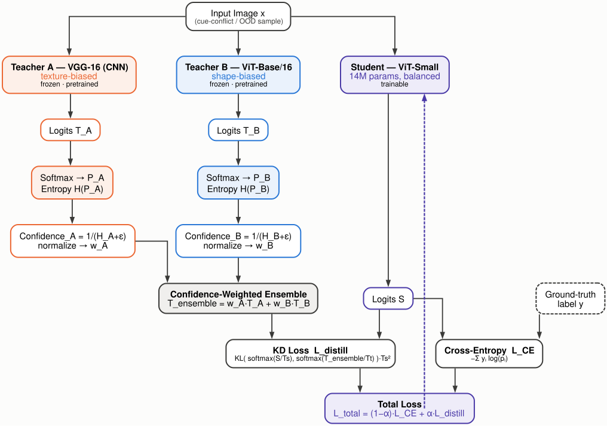
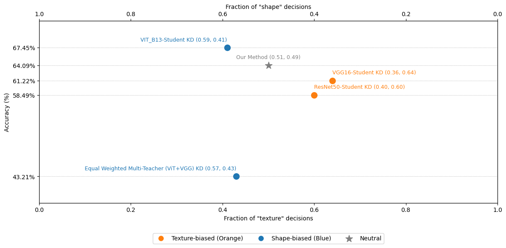

<div align="center">

# OOD Generalization via Confidence-Aware Multi-Teacher Knowledge Distillation

**Multi-teacher, single-student knowledge distillation that balances texture and shape bias for better out-of-distribution generalization.**

[](Final_ATML.pdf)
[](Final_ATML.pdf)
[](#repository-structure)

📄 **[Read the full paper (PDF)](Final_ATML.pdf)**

</div>

---

## Abstract

Deep vision models inherit strong *inductive biases* toward specific visual cues — CNNs lean on **texture**, Vision Transformers lean on **shape**. These biases boost in-distribution accuracy but hurt generalization when cues conflict or the data shifts out-of-distribution (OOD). We propose a **multi-teacher, single-student knowledge distillation (KD)** framework where each teacher is *explicitly* biased toward a different cue — a texture-biased CNN (VGG-16) and a shape-biased Vision Transformer (ViT-Base) — and the student (ViT-Small) learns to balance both. The core contribution is **confidence-aware weighted logit ensembling**: teacher contributions are dynamically weighted per-sample by the (inverse) entropy of their predictions, so the student leans on whichever teacher is more confident for that example, rather than inheriting a single dominant bias. The result is a compact student that is simultaneously more robust on stylized (texture-conflict) and Canny-edge (shape-only) OOD benchmarks than any single-teacher or naively-averaged baseline.

## Why this matters

| Problem | Our Answer |
|---|---|
| Student KD typically **inherits** whichever bias its teacher has | Use **two teachers with opposite, complementary biases** |
| Naively averaging teacher logits dilutes both signals | **Weight teachers dynamically**, per-sample, by prediction confidence (inverse entropy) |
| Large biased teachers are expensive to deploy | Distill into a **compact 14M-parameter ViT-Small** student |
| Bias is hard to quantify | Evaluate with the **Shape/Texture Cue-Conflict** protocol (Geirhos et al.) across 5 datasets |

---

## System Architecture



**How it works, end to end:**

1. **Two frozen, pre-trained teachers** see the same image: **VGG-16** (texture-biased CNN) and **ViT-Base/16** (shape-biased transformer).
2. Each teacher's logits are softmaxed and their **entropy** is computed — low entropy means the teacher is confident on this particular sample.
3. **Confidence = 1 / (entropy + ε)**, normalized across teachers into per-sample weights `w_A, w_B`.
4. Teacher logits are combined into a single **confidence-weighted ensemble logit**: `T_ensemble = w_A·T_A + w_B·T_B`.
5. The **student (ViT-Small)** is trained with a combined loss: cross-entropy against ground truth **+** a temperature-scaled **KL-divergence distillation loss** against the ensembled teacher logits.
6. Only the **student's** parameters are updated — teachers stay frozen throughout.

This lets the student adaptively lean on the texture teacher for texture-friendly inputs and the shape teacher for shape-friendly inputs, instead of uniformly inheriting one bias.

---

## Method Summary

**Distillation loss** (temperature-scaled KL divergence between student and ensembled-teacher soft labels):

```
L_distill = KL( softmax(S / Ts), softmax(T_ensemble / Tt) ) · Ts²
```

**Confidence-aware ensembling** (per-teacher entropy → confidence → normalized weight):

```
P_i = softmax(T_i)
H(P_i) = -Σ_j P_i(j) · log(P_i(j) + ε)          # entropy
Confidence_i = 1 / (H(P_i) + ε)                  # low entropy → high confidence
w_i = Confidence_i / Σ_k Confidence_k             # normalize across teachers
T_ensemble = Σ_i w_i · T_i
```

**Total training objective** (cross-entropy + distillation, balanced by α):

```
L_total = (1 - α) · L_CE + α · L_distill
```

Optimized with **AdamW** and **cosine-annealed** learning rate.

---

## Datasets

| Dataset | Role |
|---|---|
| **ImageNet-1K** | Pretraining / fine-tuning baseline (16 superclasses used for cue-conflict evaluation) |
| **Stylized ImageNet** | Texture–shape **cue-conflict** benchmark to measure bias |
| **Canny-Edge ImageNet** | Texture removed — pure shape-cue OOD generalization test |
| **Animals-10** | High visual-diversity generalization test bed |
| **Stylized Animals-10** | Cue-conflict variant of Animals-10 |

## Models

| Role | Model | Bias | Params |
|---|---|---|---|
| Teacher — Texture | **VGG-16** (CNN) | Texture-biased | — |
| Teacher — Shape | **ViT-Base/16** | Shape-biased | — |
| **Student** | **ViT-Small** | Learns a balanced representation | **14M** |

VGG-11, ResNet-50, DenseNet-121, and ViT-Small were also profiled as candidate teachers/students (see Table 1 below) before settling on this pairing.

---

## Key Results

### 1. Baseline inductive biases (before any distillation)

VGG-16 dominates on texture-rich data; ViT-Base dominates on shape-only (Canny-edge) data — confirming the complementary-bias hypothesis that motivates the whole framework.

| Model | ImageNet Standard | ImageNet Stylized | ImageNet Canny | Animals-10 Standard | Animals-10 Stylized | Animals-10 Canny |
|---|---:|---:|---:|---:|---:|---:|
| **VGG-16** | **96.16%** | **34.62%** | 18.33% | **73.22%** | **27.09%** | 12.14% |
| VGG-11 | 93.42% | 31.52% | 12.15% | 71.41% | 20.19% | 11.98% |
| **ViT-Base** | 86.44% | 26.02% | **55.83%** | 67.09% | 12.07% | **35.67%** |
| ViT-Small | 82.14% | 22.60% | 47.29% | 65.24% | 9.89% | 30.12% |
| ResNet-50 | 86.54% | 32.11% | 14.03% | 70.01% | 23.44% | 10.05% |
| DenseNet-121 | 80.31% | 28.19% | 17.22% | 69.16% | 19.89% | 10.63% |

| Model | ImageNet Shape Bias | ImageNet Texture Bias | Animals-10 Shape Bias | Animals-10 Texture Bias |
|---|---:|---:|---:|---:|
| VGG-16 | 0.14 | **0.86** | 0.20 | **0.80** |
| VGG-11 | 0.21 | 0.79 | 0.27 | 0.73 |
| **ViT-Base** | **0.64** | 0.36 | **0.59** | 0.41 |
| ViT-Small | 0.59 | 0.41 | 0.56 | 0.44 |
| ResNet-50 | 0.29 | 0.71 | 0.31 | 0.69 |
| DenseNet-121 | 0.23 | 0.77 | 0.38 | 0.62 |

### 2. Student bias after distillation — single-teacher vs. ours



| Setup | Accuracy | Shape Bias | Texture Bias |
|---|---:|---:|---:|
| VGG16 → Student KD | 61.22% | 0.36 | 0.64 |
| ViT-B16 → Student KD | **67.45%** | 0.59 | 0.41 |
| Equal-Weighted Multi-Teacher KD | 43.21% | 0.57 | 0.43 |
| **Confidence-Aware Multi-Teacher KD (ours)** | 64.09% | **0.49** | **0.51** |

Single-teacher KD simply **inherits** the teacher's bias (e.g. VGG16→student stays texture-heavy at 0.64). Naive equal-weight averaging *collapses accuracy* to 43.21%. **Our method is the only one that lands near the 0.5/0.5 balance point**, at a small, acceptable accuracy cost versus the single-teacher ceiling.

### 3. OOD generalization — the actual payoff

| Method | Stylized Accuracy (texture-conflict) | Canny-Edge Accuracy (shape-only) |
|---|---:|---:|
| VGG-16 → Student KD | **29.14%** | 17.34% |
| ViT-B16 → Student KD | 21.89% | 30.20% |
| Equal-Weighted Multi-Teacher KD | 11.43% | 7.06% |
| **Confidence-Aware Multi-Teacher KD (ours)** | 28.89% | **31.12%** |

Every baseline wins on exactly **one** cue and fails on the other. Our confidence-aware student is the only model that is competitive on **both** — within 0.25pp of the best stylized result *and* the best Canny-edge result — making it the most balanced, OOD-generalizable model overall.

---

## Takeaways

- CNNs (VGG) and ViTs encode **genuinely complementary** inductive biases — texture vs. shape — confirmed consistently across two independent datasets.
- Naive knowledge distillation **propagates teacher bias** to the student regardless of student architecture.
- **Equal-weight** multi-teacher ensembling is actively harmful — it blurs both signals and tanks accuracy.
- **Entropy-based confidence weighting** lets the student dynamically trust the more-confident teacher per sample, yielding the most balanced shape/texture bias (0.49 / 0.51) and the best combined OOD performance, at a modest cost to in-distribution accuracy.

## Limitations & Future Work

- The confidence-aware student does not beat the best **single**-teacher accuracy (ViT-B16→Student, 67.45%) — a trade-off from heterogeneous teacher architectures and logit-only (not feature-level) distillation.
- Future work: smarter dynamic weight allocation, and **hint/feature-based distillation** that aligns VGG and ViT representations in a shared latent space before logit matching.

---

## Repository Structure

```
.
├── Final_ATML.pdf                 # Full paper
├── T_Vgg16_CNN.py                 # Texture-biased teacher (VGG-16)
├── T_Vgg11_CNN.py                 # Candidate teacher (VGG-11)
├── T_ResNet50_CNN.py              # Candidate teacher (ResNet-50)
├── T_DenseNet121.py               # Candidate teacher (DenseNet-121)
├── T_VIT_Transformer.py           # Shape-biased teacher (ViT-Base)
├── S_Vgg11_CNN.py                 # Student variant built on VGG-11
├── confidence-aware-kd.ipynb      # Confidence-aware multi-teacher KD framework
├── atml-experiments.ipynb         # Baseline / ablation experiments
├── cueconflict-animal-10.ipynb    # Stylized Animals-10 cue-conflict pipeline
├── ImageNetLabelling.ipynb        # ImageNet superclass labelling utilities
├── visualisations.ipynb           # Results plots (incl. Figure 1)
├── mid-report.ipynb               # Intermediate milestone report
└── catagories.txt                 # Superclass category mapping
```

## Authors

**Abdullah Hashmat**
Research Project · 2024
